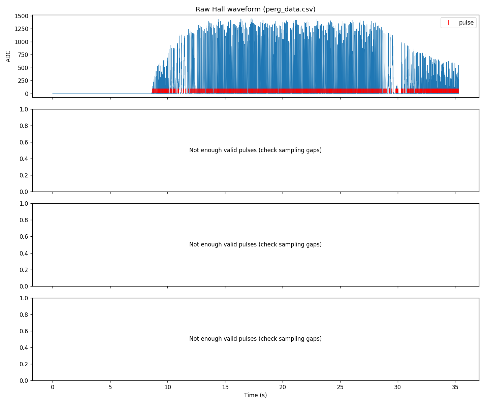

# Perg Logger

ESP32 and Python tools for recording and analyzing the raw Hall-effect sensor
signal from a Perg rowing machine flywheel.

The ESP32 sketch samples the Hall sensor on GPIO 27 at 1 kHz and streams CSV
rows over USB serial. The Python recorder saves those rows to `perg_data.csv`,
and the analyzer detects pulses, estimates flywheel RPM, and attempts to
summarize rowing strokes.

## Files

- `perg_logger.ino` - ESP32 sketch that samples the Hall sensor and streams
  `time_us,adc_value`.
- `record_perg.py` - serial logger that records the ESP32 stream to
  `perg_data.csv`.
- `analyze_perg.py` - analysis script that creates plots and stroke summaries.
- `perg_analysis.png` - example analysis plot from a recorded session.

## Wiring

- Perg 3.5 mm left/signal terminal to ESP32 GPIO 27 through a 10 kOhm resistor.
- Perg 3.5 mm ground terminal to ESP32 ground.
- The right terminal is not used.

## Setup

```bash
python3 -m pip install pyserial numpy scipy matplotlib
```

Upload `perg_logger.ino` to the ESP32, then record data:

```bash
python3 record_perg.py
```

If auto-detection does not find the ESP32, pass the serial port explicitly:

```bash
python3 record_perg.py /dev/cu.usbserial-210
```

Analyze the captured CSV:

```bash
python3 analyze_perg.py
```

## Example Output



Caption: Raw Perg Hall-effect sensor recording. The top panel shows ADC pulses
from flywheel magnets; red tick marks show detected pulse crossings. The lower
RPM, acceleration, and stroke-rate panels are empty for this recording because
the analyzer found too few valid pulse intervals after checking sampling gaps.

## Notes

- The current RPM conversion assumes 8 magnets on the flywheel.
- The ESP32 ADC clips negative voltage, so this captures the positive half of
  the Hall signal. A DC-bias circuit would improve future measurements.
- `perg_data.csv` and `perg_strokes.csv` are generated locally and are ignored
  by git.
