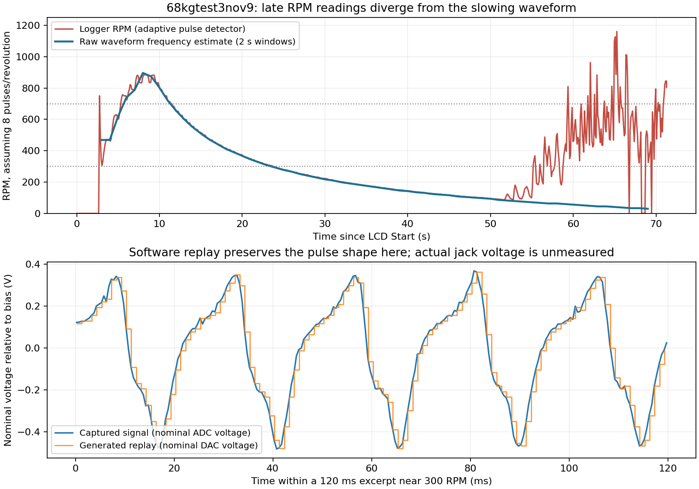

# Capture and calibration progress - November 9, 2026

## Current status

Named recordings, LCD Start/Stop control, raw-signal replay, and synthetic
coast-down generation are implemented. **Reproducing an accepted drag factor
of 59 on the original monitor has not been demonstrated.** A flashing value
of 80 is not a successful calibration measurement.

The [KayakPro console manual](https://kayakpro.com/download/admin/uploads/67ced7edc052e_1741608941.pdf)
describes entering drag calibration, accelerating above 700, allowing an
unimpeded coast-down, and accepting the result when the drag field stops
flashing. The user reports that their real calibration updates near 300 RPM.
The firmware's internal acceptance criteria are not known.

## Implemented and checked

- The recorder prompts for a session name and refuses existing folders.
- The updated CYD has one Start/Stop touchscreen button. Its first boot runs
  touch calibration; holding the screen during reset repeats calibration.
- With `--start-on-button`, USB arming clears time/distance without requiring
  precisely timed reset presses. Lost arming commands are retried until ready.
- LCD Start begins the timer and capture; Stop freezes time/distance and closes
  the CSV files. RPM and voltage remain live. Ctrl+C closes the capture but does
  not itself stop the LCD session.
- The original automatic motion start was replaced after early false triggers.
  The old `--start-on-motion` argument is now a documented compatibility alias
  for button-controlled recording.
- Replay resamples by timestamps: a 2 kHz recording is no longer played as
  one sample per 1 ms (which would approximately double its duration).
- One-pass replay waits for the hardware ring to drain before stopping. Dry
  runs never open serial ports. Several connected boards require an explicit
  player port rather than selecting the first device.
- Cleanup added strict CSV validation and monotonic host timing, corrected
  LIN checksum/PID parity calculations, bounded player packet parsing, and
  stopped untimed ring-buffer consumption on overflow.

The LIN decoder fixes follow Microchip's [data-link description](https://developerhelp.microchip.com/xwiki/bin/view/applications/lin/data-link-layer/)
and [checksum description](https://onlinedocs.microchip.com/oxy/GUID-FE7C04FE-3F77-40DF-9EBC-0B59D367E555-en-US-4/GUID-DBED8F22-4AC2-42F9-8159-DA9CA689AF03.html).
The repository does not contain the optional LIN sniffer sketch or a validated
capture from the monitor's LIN connector.

## Real recordings

Original files were copied byte-for-byte from local captures. The
[manifest](../../data/sessions/2026-11-09/manifest.json) records their original
names, sample counts, timing checks, and SHA-256 hashes. The label `drag59`
records the user's reported physical-machine calibration; it is not a value
computed or independently verified by these tools.

| Archived session | Original name | Raw rows | Raw duration | Notes |
| --- | --- | ---: | ---: | --- |
| `68kg_drag59` | `68kg59Drag Nov9` | 72,022 | 36.0324 s | Motion-start capture; early false triggers; two gaps above 1.5 ms; ends around logged 235 RPM. |
| `68kg_drag59_test2` | `68kg59DTest2nov9` | 43,500 | 21.749249 s | Button capture; ends around logged 298 RPM, before a complete stop. |
| `68kg_test3` | `68kgtest3nov9` | 142,540 | 71.269438 s | Button capture; no gaps above 1.5 ms; late calculated RPM is unreliable. |

These files retain ESP32 sensor values and session-relative timestamps; no
filtering, re-zeroing, or estimated RPM was written into their raw CSVs.

## Signal findings

The raw `68kg_test3` waveform contains a sustained spin-down. Two-second FFT
windows, assuming eight sensor cycles per revolution, give approximately
720 RPM at 10-12 s, 345 RPM at 20-22 s, 266 RPM at 25-27 s, and 40 RPM at
65-67 s. These are offline estimates, not a validated tachometer reference.

Around 50 s the firmware's adaptive pulse detector begins reporting erratic
higher RPM while the underlying waveform continues slowing. This is consistent
with extra noise crossings as signal amplitude falls. The detector needs further
work; its sensitivity has not been retuned here.

The [frequency estimates](../../data/sessions/2026-11-09/raw_frequency_estimates.csv)
use 2 s Hann windows stepped every 1 s, a 2-200 Hz search band, and
`RPM = frequency * 60 / 8`. The plotted replay is a software prediction, not a
measurement at the SPD input.

Replay uses **raw samples**, not the telemetry RPM, watts, or the logger's fixed
`DRAG_COEFF = 61`. Therefore the RPM display bug does not directly set the
original monitor's replayed drag factor. Power/pace/distance are still based on
an approximate, uncalibrated model.

The player still uses 1 ms DAC updates. Illustrative threshold crossings in the
coast-down become alternating 11/12 ms intervals where the source is near
11.5 ms. This quantization and the physical circuit may affect calibration, but
neither has been established as the cause of rejection. Correct total duration
does not prove accurate pulse timing at the monitor.

## Synthetic experiments

Both trials are archived under [data/synthetic/2026-11-09](../../data/synthetic/2026-11-09).
They are explicitly synthetic. The model is
`dRPM/dt = -(a * RPM^2 + b)` with the illustrative term `b = 1 RPM/s`.
`a` fits the reference recording's estimated **12.3867 s** interval from
700 to 300 RPM, then scales by requested/reference drag. This scaling is a
hypothesis, not a reverse-engineered or validated monitor algorithm.

| Trial | Generated peak / hold | Observed result | Status |
| --- | --- | --- | --- |
| `drag59_trial01` | 760 RPM / 1 s | User saw a maximum of 680 RPM; 80 remained flashing. | Failed to reach the displayed threshold; stopped early. No accepted drag. |
| `drag59_trial02` | 840 RPM / 5 s | No confirmed observation in this conversation. | Prepared and dry-run checked; execution/result unconfirmed. |

Each archive includes the synthetic raw CSV, intended RPM profile, model
metadata, a result record, and checksums. Trial 1 also includes its replay log.
The archived reference path was made repository-relative; trial 1's known
stage durations were added to its metadata. Raw waveform/profile files are
unchanged. Synthetic traces cannot establish the machine's physical drag.

## Hardware findings and remaining work

The existing code describes GPIO 25 DAC output through an AC-coupling network
with 10 uF, 470 ohm, and a 100 kohm bleed. The actual breadboard wiring, monitor
input impedance, connector contact assignment, voltage, and pulse timing have
not been measured or verified in this work. See [replay wiring notes](../replay_wiring.md).

The user has an 8-pin LM741 and only USB/5 V available. The supplied TI datasheet's
recommended supply table starts at +/-10 V. A USB-only LM741 replacement was
not designed or built. A 5 V-compatible MCP6002 or a separate LM741 dual supply
was proposed; component selection and breadboard layout remain pending.

Next useful measurements:

1. Confirm a sustained displayed speed above 700 during synthetic trial 2.
2. Record whether the drag field stops flashing and, only then, its accepted value.
3. Measure the replay waveform at the actual SPD input, especially during the
   700-to-300 interval, and compare pulse counts and elapsed time with the source.
4. Measure underruns/missed DAC ticks and evaluate finer playback timing.
5. Repair low-speed noise rejection before trusting the custom LCD's late RPM.

## Validation

`python3 -m unittest discover -s tests -v` covers capture overwrite protection,
arming retries, button start/stop boundaries, CSV validation, 1/2 kHz resampling,
no-port dry runs, full playback drain, synthetic phase/coast/idle behavior, and
LIN checksum/parity vectors. ESP32 firmware builds are checked with Arduino
CLI and `esp32:esp32:esp32`. These checks do not establish drag-calibration
accuracy, analog output accuracy, or touchscreen operation on every CYD variant.
